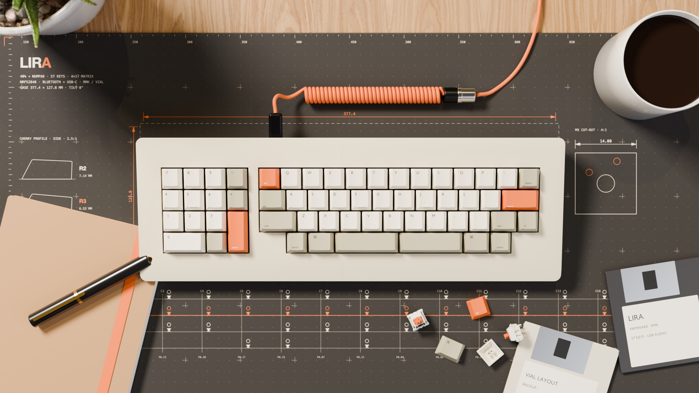

# Lira

A 40% keyboard in the [KBDfans Agar Mini](https://kbdfans.com/products/agar-mini) layout, with a numpad on the
left and a split 3u + 3u spacebar.
Bluetooth + USB-C, hot-swap MX switches, RMK firmware with Vial, and a built-in USB sound card (3.5 mm headset jack
at the back: headphones and microphone, with a headphone amplifier; on only in USB mode). It also works without a
battery, from the cable alone. 3D-printed case inspired by the Apple
M0110 (1984), top mount: the plate is screwed to the top frame and the PCB hangs from the switches, so no printed
part has to hold the PCB flat.



## Inspiration and credits

None of the ideas here are mine: this board is a combination of things other people made, plus the one thing I
always wanted and could not buy — a headset jack on a keyboard.

- **Layout** — the 40% block with the split 3u + 3u spacebar is KBDfans' [Agar Mini](https://kbdfans.com/products/agar-mini).
  The numpad on the left is my addition, and what makes it 57 keys.
- **Board** — the "40% + numpad in one flat rectangular case" idea and the overall proportions are inspired by the
  [**Lyra**](https://github.com/PiKeeb/lyra-keyboard), designed by **alexbarb** (case) with the PCB by **KGOH** and
  **ILWrites**. Lira is not a copy: it uses the Agar Mini body, a top-mount case and a completely different PCB.
- **The 3.5 mm headset jack** — laptop headphones + microphone built into the keyboard itself. The sound card follows
  C-Media's own CM108B reference design behind a CH334P USB hub (see
  `production/5-schematic-and-checks/differences-from-bluemicro840.txt`).
- **Power, USB and programming** — the BlueMicro840 ([jpconstantineau/NRF52-Board](https://github.com/jpconstantineau/NRF52-Board)),
  a board built with the same Ebyte E73 module; the differences are listed in the same file.
- **Case** — the shape and colour follow the Apple M0110 (1984).

Thanks to all of them.

## Where to find things

| Folder | What it contains |
|---|---|
| **[`production/`](production/README.md)** | Everything to build the 57-key keyboard: files for JLCPCB, plate, case to print, firmware, pictures |
| [`guide/`](guide/build-guide.md) | Complete guide: ordering from JLCPCB, what to buy, first programming, printing and assembly |
| [`source/`](source/README.md) | The code that generates everything: edit only here, then regenerate |

`production/` is **self-contained**: it holds everything needed to build the keyboard (the bootloader too)
and has its own README listing the files and what to do with them:

```
production/
├── README.md                what's inside and what to do with it
├── 1-pcb-jlcpcb/            gerber-pcb.zip, bom.csv, cpl.csv
├── 2-plate/                 the plate: JLCPCB (FR4 gerbers), laser cut (DXF) or 3D printed (2 STL)
├── 3-case-3d-print/         the 4 STL pieces (+ step/)
├── 4-firmware/              .uf2 firmware, .hex bootloader, vial.json
├── 5-schematic-and-checks/  schematic (PDF) and the results of the automatic checks
├── kicad/                   PCB, plate and schematic to open in KiCad
└── images/                  layout, Blender renders: on a desk, every side, exploded, PCB
```

> `production/` is **rewritten** on every regeneration: do not edit it by hand.

## How reliable it is

Everything below is checked on paper and in software, **not a tested board** (see the warning at the top).

The circuit, PCB, case and firmware are generated and checked automatically on every build:

- the power / USB / programming circuit follows the BlueMicro840 and the sound card follows C-Media's
  CM108B/CM119B demo board; the differences from both are listed in
  `production/5-schematic-and-checks/differences-from-bluemicro840.txt`;
- KiCad's ERC, a pin-by-pin check between circuit, PCB and schematic, and datasheet tests written independently
  of the design (`erc-kicad.txt`, `consistency-check.txt`, `datasheet-checks.txt`);
- a mechanical fit check of the case against the finished PCB (`fit-check.txt`).

These checks reduce the risk; they do not replace a prototype. The guide, §8, lists what to verify on the first
board.

## Small hardware

| Item | Quantity |
|---|---|
| M2 heat-set inserts (for a 3.2 mm hole, length 3 mm) | 10 (top frame: the plate's ears) |
| M2 × 5 mm socket-head screws (DIN 912) | 10 (plate to top frame) |
| Short M3 heat-set inserts (Ø ~4.5 mm, length 3 mm) | 14 (top frame) |
| M3 × 12 mm screws | 11 (front and sides) |
| M3 × 20 mm screws | 3 (back: through the PCB's holes and the plate's tabs) |
| Ø 3 × 14 mm alignment pins (steel rod or 3 mm filament) | 4 |
| Ø 12 mm rubber feet | 4 |
| 1 mm foam (under the battery) | one 55 × 37 mm piece |
| Long 2.5 mm hex key (some M3 screw holes are 21 mm deep) and a 1.5 mm hex key (M2) | 1 + 1 |

## Printing the case

- No supports. **Top frames**: flat face down on the bed. **Bottom halves**: placed the way they sit
  on the desk.
- PLA or PETG, 3 perimeters, 5 solid top layers and 4 bottom layers. Infill: **top frames** gyroid 15 %,
  **bottom halves** gyroid 8 % or lightning. The strength comes from the walls and the solid layers, not from
  the inside.
- Material (estimate, PLA): about 300–320 g this way, versus about 370 g with 15 % everywhere. The bottom halves
  are already 85 % empty inside: designing cavities into them would cost **more** (tried it: 290 g instead of
  273 g), because every cavity adds walls, a ceiling and ribs that print solid.
- For the fine texture of the M0110: light "fuzzy skin" (0.1 mm) on the outer surfaces, or textured spray
  paint.
- Reference colour: warm beige between `#C8C2A0` and `#D5D0B4` (Pantone 453 was the original).
- The case is split to fit a 256 mm bed: with a bigger printer, change `BED` in
  `source/case/gen_case.py` and regenerate.

## Editing and regenerating

Edit only `source/` (for example `layout.py` for the keys, `case/gen_case.py` for the case), then:

```sh
cd source
make all            # regenerates everything (about 25 minutes on an M4, most of it the Blender renders)
make pcb            # or a single step: see source/README.md
```

Technical details in [`source/README.md`](source/README.md).

## License

[MIT](LICENSE) — that covers everything in this repository that I made.

Bundled third-party parts keep their own terms and are **not** relicensed by the above: `source/tools/KeyV2`
(GPL-3.0, a git submodule), the kiswitch footprints and 3D models under `source/lib/` (CC BY-SA 4.0), and the
vendor symbols/models (KiCad, LCSC). The [Lyra](https://github.com/PiKeeb/lyra-keyboard) and the KBDfans Agar Mini
are cited as inspiration only — no files from either are included here.
